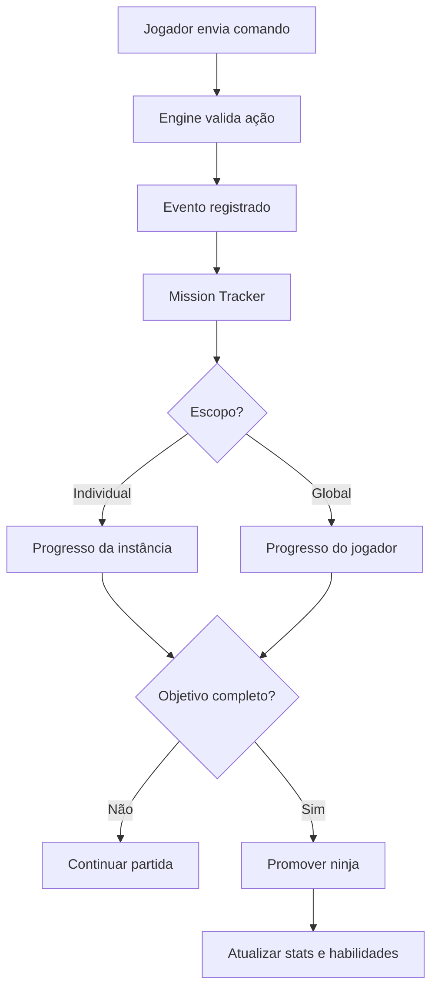
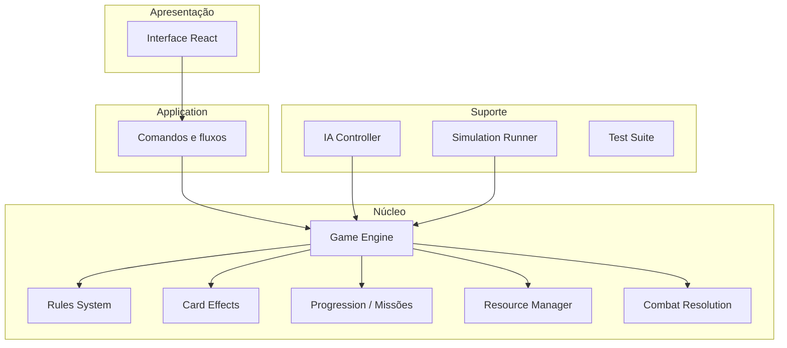
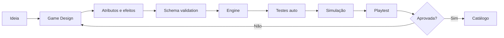

# Pesquisa de Game Design e Engenharia — Shinobi CardGame

**Tipo:** pesquisa técnica aplicada ao projeto  
**Data:** novembro de 2026  
**Documentos relacionados:** [01](./01-fundamentos.md) · [02](./02-criacao-evolucao.md) · [03](./03-manual-profissional.md) · [05-conhecimento](./05-conhecimento-card-games.md) · [06-fontes-naruto](./06-fontes-naruto-cartas.md)

---

## Sobre este documento

Esta pesquisa é uma etapa de **fundamentação do projeto**, não uma lista de tecnologias para experimentar sem critério.

**Objetivo:** identificar como desenvolver um card game digital estratégico com:

- progressão de personagens (linear: Gennin → Chuunin → Jounnin);  
- jutsus gerados (fora do deck);  
- combate reativo e pilha de resolução;  
- IA heurística;  
- balanceamento orientado por dados.  

**Premissa:** nem toda técnica de *Legends of Runeterra*, *Magic: The Gathering* ou *Hearthstone* deve ser copiada. O foco é entender **quais problemas** cada técnica resolve e adotar o que faz sentido para o Shinobi CardGame.

### Seis áreas do estudo

1. Game Design de card games competitivos  
2. Construção de cartas, habilidades e progressão  
3. Arquitetura e engenharia da engine  
4. IA adversária e simulação de partidas  
5. Balanceamento, métricas e playtesting  
6. Tecnologias, ferramentas e pipeline  

### Decisões do projeto (referência rápida)

| Tópico | Decisão |
|--------|---------|
| Classificação de produto | **CCG** (sem trade/venda entre jogadores) — ver [07-produto-ccg](./07-produto-ccg.md) |
| Arquétipos | Base: Aggro, Mid, Control, Combo (+ subtipos) |
| Raridade | 4 níveis (C/I/R/L); afeta pack/craft/coleção, não poder nem visual — [07](./07-produto-ccg.md) |
| Deck | 24 cartas |
| Evolução | Linear, sem ramificação |
| Progresso | Híbrido (global + individual por instância) |
| Jutsus exclusivos | Gerados em runtime, não no deck |
| MVP | **Só vs IA**; ranked/PvP online fora do MVP |
| Engine | Independente da UI; mesma lógica para humano e IA |
| Balance | Power budget como referência + planilha + testes + simulação |
| Coleção | F2P completo no poder; pool estável; formato único (v1) |

---

## 1. Fundamentos de Game Design para card games

### 1.1 Card Advantage

**Card Advantage** é a vantagem de gerar mais valor com cartas do que o adversário.

*Exemplo:* uma carta remove dois ninjas rivais; o rival gasta duas cartas para responder — vantagem para quem removeu.

**No Shinobi:** jutsus multi-alvo, draw, geração de jutsus, remoções com custo/sacrifício. Avaliar cartas pelo **custo em cartas e Chakra**, não só pelo dano.

### 1.2 Tempo

**Tempo** é desenvolver o próprio plano enquanto limita o adversário.

| Arquétipo | Uso de tempo |
|-----------|--------------|
| Aggro | Chakra → pressão |
| Midrange | Campo + evolução |
| Control | Aceita perder tempo por vantagem futura |
| Combo | Prepara sequência |

**Risco de design:** evolução tão eficiente que torne outros planos irrelevantes.

### 1.3 Risk vs Reward

| Decisão | Risco | Recompensa |
|---------|-------|------------|
| Evoluir ninja | Investimento | Poder / nova função |
| Reservar Chakra | Menos ações | Resposta |
| Jutsu forte | Recurso | Impacto |
| Preparar combo | Tempo | Vitória |
| Armadilha / Oculto | Depender do rival | Interrupção |

OTKs **raros** devem exigir preparação, investimento e janela de counterplay.

### 1.4 Archetype Identity

| Arquétipo | Objetivo | Mecânicas típicas |
|-----------|----------|-------------------|
| **Aggro** | Vencer antes do rival desenvolver | Ataque rápido, baixo custo, dano direto |
| **Midrange** | Vantagem progressiva | Missões, promoção, sinergia, versatilidade |
| **Control** | Administrar ameaças e ritmo | Remoção, defesa, Chakra, interrupção |
| **Combo** | Sequência poderosa | Sinergia, gerados, acúmulo, condicionais |
| **Ocultos** | Punir com informação incompleta | Segredo, revelação, preparação |

**Arquétipos oficiais (produto):** base **Aggro · Midrange · Control · Combo**; subtipos permitidos (ex.: Ocultos, Evolução, Swarm). Ver [07-produto-ccg](./07-produto-ccg.md).

**Meta desejado (ciclo):** Midrange → Aggro → Control → Combo → Midrange.

### 1.5 Design iterativo

1. Exploratory Design  
2. Vision Design  
3. Set Design  
4. Play Design  

A carta só está “pronta” após teste **no arquétipo** e no meta.

---

## 2. Técnicas específicas para o Shinobi CardGame

### 2.1 Progressão híbrida: Event-Driven Progression

Progresso híbrido deve reagir a **eventos** registrados pela engine.

**Eventos ilustrativos:** `NINJA_ATTACKED`, `NINJA_DEALT_DAMAGE`, `UNIT_DESTROYED`, `JUTSU_CAST`, `PLAYER_DEALT_DAMAGE`, `CHAKRA_SPENT`, `MISSION_PROGRESS_UPDATED`, `NINJA_PROMOTED`.



**Missão individual (exemplo):**

```json
{
  "id": "naruto_chunin_mission",
  "scope": "individual",
  "owner": "unit_instance_id",
  "event": "NINJA_DEALT_DAMAGE",
  "target": 5,
  "progress": 0
}
```

**Missão global (exemplo):**

```json
{
  "id": "team_training",
  "scope": "global",
  "event": "JUTSU_CAST",
  "target": 4,
  "progress": 0
}
```

**Técnicas:** event-driven, handlers, state machines, **instance_id** por unidade, histórico, missões declarativas.

### 2.2 Jutsus gerados: Data-Driven Card Generation

MVP: **templates** por personagem (não geração procedural livre).

| Conceito | Papel |
|----------|--------|
| Template | Definição estável |
| Instância | Carta gerada na partida |
| Efeito | Execução no motor |

**Segurança:** catálogo fechado de efeitos (DSL).

### 2.3 Pilha de resolução e prioridade

`ResolutionStack` + `PriorityManager`; LIFO; revalidação de alvos; limite de profundidade anti-loop.

---

## 3. Arquitetura e engenharia da engine

### 3.1 Camadas



**IA:** consulta ações legais da engine; **não** reimplementa regras.

### 3.2 Command Pattern

Pipeline: validar fase → recursos → alvos → regras → aplicar → eventos. Humano, IA e simulador usam a **mesma entrada**.

### 3.3 Event log e replay

MVP: estado autoritativo + log imutável (não Event Sourcing completo até precisar).

### 3.4 Determinismo e seed

`GameEngine({ seed })` — registrar seed, comandos, versão das regras e dos dados.

### 3.5 FSM de turno/combate

Draw → Main → Combat → ResponseWindow → StackResolution → End → Draw ou Victory.

### 3.6 Testes

Unitários, integração, property-based (Chakra ≥ 0, promoção uma vez por rank), simulação. Ferramentas: `tsx`, Vitest, fast-check (futuro).

---

## 4. IA adversária

**MVP:** heurística por fase — não ML/RL/MCTS como requisito inicial.

| Critério | Peso ilustrativo |
|----------|------------------|
| Aproximação da vitória | 10 |
| Preservar ninjas | 8 |
| Evolução | 7 |
| Vantagem de Chakra | 6 |
| Card advantage | 5 |
| Dano causado | 4 |
| Preparar combo | 3 |

**PlayerObservation** — sem espiar mão/deck/ocultos rivais.

Evolução futura: heurística → pesos por arquétipo → busca curta → MCTS/PIMC.

---

## 5. Balanceamento, métricas e playtesting

Power ≈ Base + Effect + Synergy + Flexibility (orientação, não lei). Avaliar **decks**.

**Métricas:** win rate, duração, turno de vitória, taxa de promoção, uso de Chakra, geração de jutsus.

Playtest: exploratório, competitivo, cego.

---

## 6. Tecnologias e ferramentas

**Stack preferida:** TypeScript (`src/engine/`) + React + `tsx`/Vitest + GitHub Actions.

| Subsistema | Técnica |
|------------|---------|
| Estado | FSM |
| Missões | Event-driven |
| Ações | Command |
| Cartas | JSON / TypeScript data |
| Efeitos | DSL + registry |
| Jutsus gerados | Factory |
| IA | Heurística |
| Balance | Monte Carlo + planilha |

Ferramentas: Google Sheets, Excalidraw, Figma.

---

## 7. Pipeline de criação de cartas



Versionamento por carta: ID permanente, versão, data, motivo, resultados de testes.

---

## 8. Metodologia de desenvolvimento (7 etapas)

1. Pesquisa e especificação  
2. Prototipagem  
3. Implementação (engine sem UI)  
4. Validação técnica  
5. Simulação  
6. Playtest humano  
7. Ajuste e documentação  

---

## 9. Roadmap técnico priorizado

| Prioridade | Técnica | Aplicação |
|------------|---------|-----------|
| **P0** | State Machine | Fases e combate |
| **P0** | Command Pattern | Ações |
| **P0** | Event-Driven | Missões híbridas |
| **P0** | Data-Driven | Cartas e efeitos |
| **P0** | Factory | Jutsus gerados |
| **P0** | Unit tests | Regras core |
| **P1** | Property-based | Invariantes |
| **P1** | IA heurística | Adversário |
| **P1** | Replay determinístico | Debug |
| **P1** | Monte Carlo | Balance |
| **P1** | Power budget | Planilha |
| **P2** | Behavior trees / MCTS / Dashboard | Avançado |

### Primeiro ciclo (4 semanas — ilustrativo)

| Semana | Foco |
|--------|------|
| 1 | Regras, arquitetura, modelo de estado, FSM |
| 2 | Comandos, eventos, missões híbridas, catálogo de efeitos |
| 3 | Factory de jutsus, validação, testes pilha/promoção |
| 4 | Simulador, IA heurística, seeds, confrontos |

---

## 10. Bibliografia e referências

- Wizards — Playtesting, Tempo & Card Advantage, Iteration  
- Riot — Engineering Tools for Designers (LoR), Bringing Features to Life  
- MCTS reviews; Chaos Cards (AIIDE); balanceamento por Monte Carlo  
- fast-check, Hypothesis  

---

## 11. Cinco investimentos principais

1. Engine orientada a eventos  
2. Cartas declarativas  
3. Simulador de partidas  
4. IA heurística modular  
5. Pipeline de design + playtest  

**Opinião técnica:** o diferencial é **engine flexível** para evolução, jutsus gerados, missões e pilha.

---

## 12. Documentação permanente

| Arquivo | Conteúdo |
|---------|----------|
| `docs/DESIGN/01-fundamentos.md` | Fundamentos gerais de card games |
| `docs/DESIGN/02-criacao-evolucao.md` | Manual criação + evolução linear |
| `docs/DESIGN/03-manual-profissional.md` | Manual profissional end-to-end |
| `docs/DESIGN/04-pesquisa-shinobi.md` | Este documento (aplicado ao projeto) |
| `docs/DESIGN/05-conhecimento-card-games.md` | Síntese indústria + fontes + checklist |
| `docs/DESIGN/06-fontes-naruto-cartas.md` | Catálogo de fontes Naruto (oficial → secundário → mapping → IP) |
| `docs/RULES/core-rules.md` | Regras oficiais do jogo |
| `docs/architecture.md` | Mapa do repositório |

---

## 13. Dados oficiais de Naruto — fontes, APIs e base própria

Separar: (1) fontes para consultar o conteúdo original; (2) fontes para dados estruturados (JSON/API).

**Catálogo completo (tabelas, pipeline, IP):** [06-fontes-naruto-cartas.md](./06-fontes-naruto-cartas.md).

**Observação:** não há, em geral, API pública oficial da franquia em JSON. Caminho realista: **fontes oficiais + base própria**.

### 13.1 Fontes oficiais

| # | Fonte | Onde |
|---|--------|------|
| 1 | Official Character Data Book | [Narutoversity — databooks](https://narutoversity.wordpress.com/databooks-and-fanbooks/) · [VIZ](https://www.viz.com/read/manga/naruto-official-character-data-book) |
| 2 | Site oficial | https://naruto-official.com/en/ |
| 3 | Official Fanbook | Narutoversity (índice) |
| 4 | Secret Manual – Book of War | Catálogo VIZ / Shueisha |

### 13.2 Dados comunitários

| Recurso | URL |
|---------|-----|
| [NarutoDB](https://narutodb.xyz/) | https://narutodb.xyz/ |
| [Naruto Wiki](https://naruto.fandom.com/) | https://naruto.fandom.com/ |
| [Site oficial](https://naruto-official.com/en/) | https://naruto-official.com/en/ |

APIs/wikis **aceleram** catalogação; **não** substituem validação.

### 13.3 Base própria no Shinobi CardGame

Módulos: `characters`, `jutsus`, `bloodlines`, `items`, `lore` — distintos de `CardDef` jogável (`src/data/cards.ts`).

Pipeline: Data Book/site → validação humana; NarutoDB/wiki → importação → validação → catálogo → CardDef → testes.

### 13.4 Propriedade intelectual

Acesso a informações **não** autoriza uso comercial de imagens, logos ou personagens. Avaliar termos VIZ / licenciador.

### 13.5 Estratégia

1. Data Book + site oficial (validação)  
2. NarutoDB com `source: "community"`  
3. Import → review → cards  
4. Mapeamento `lore_id` → `card_id`  

---

## Apêndice A — Restrições arquiteturais (v0.2)

- Sem regras de combate em componentes React  
- Sem duplicar lógica IA vs jogador  
- Sem usar `card_id` como ID de unidade em campo  
- Sem misturar cartas geradas com deck montável  
- UI não decide resultado — motor valida  
- Deck 24 sem alteração não autorizada  
- Sem progressão ramificada  

---

## Apêndice B — Critério de qualidade

Toda mecânica nova: testes de comportamento, limites e interações. Refatoração sem mapear impacto e regressão é proibida.

---

*Fim do documento.*
