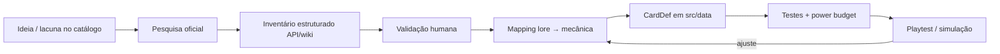

# Fontes Naruto para criação de cartas

**Tipo:** base de conhecimento (pesquisa de fontes)  
**Data:** novembro de 2026  
**Documentos relacionados:** [04-pesquisa-shinobi](./04-pesquisa-shinobi.md) (§13) · [02-criacao-evolucao](./02-criacao-evolucao.md) · [05-conhecimento-card-games](./05-conhecimento-card-games.md) · dados em `src/data/`

---

## 1. Objetivo

Catalogar **fontes oficiais e secundárias de qualidade** para inspirar e validar cartas do Shinobi CardGame (stats relativos, nomes de jutsu, patentes, vilas, lore → mecânica), sem scrapes ilegais e sem reproduzir texto/arte protegidos.

**Premissas:**

- Não existe API JSON pública oficial da franquia; o caminho realista é **fonte oficial (validação) + base própria (`src/data/`)**.
- Fontes comunitárias **aceleram** o inventário; nunca substituem revisão humana nem autorizam uso comercial da IP.
- Stats de databook (números 1–5 de atributos, etc.) são **inspiração de identidade**, não cópia literal para Poder/Vida/custo.

---

## 2. Fontes oficiais

| Nome | URL | Dados úteis | Confiabilidade | Cuidado IP / licença | Uso no Shinobi CardGame |
|------|-----|-------------|----------------|---------------------|-------------------------|
| **NARUTO Official Site** | https://naruto-official.com/en/ | Elenco, resumos de anime/manga, livros relacionados, notícias, produtos (incl. card game oficial) | Oficial (TV Tokyo / parceiros da franquia) | Conteúdo e imagens do site são propriedade dos detentores; não espelhar assets no repo | Âncora de **canonicidade de nomes**, vilas e arco; checagem de elenco oficial vs. `faction` / `role` |
| **Official Site — Comics** | https://naruto-official.com/en/comics | Índice dos 72 volumes (capítulos por volume) | Oficial | Mesmo | Mapear “fase clássica” do catálogo (Parte I) aos volumes certos |
| **Official Site — Related Titles / Data Book** | https://naruto-official.com/en/books | Índice de novels, artbooks, **Official Character Data Book** | Oficial (catálogo) | Compra oficial; não digitar páginas inteiras | Descobrir **quais** publicações oficiais existem; comprar para validar perfil/jutsu |
| **Official Site — Anime NARUTO** | https://naruto-official.com/en/anime/naruto1 | Sinopse, staff, cast (JP), streaming por região | Oficial | Imagens/áudio protegidos | Confirmar nomes canônicos e afiliação Time 7 / cast para flavor |
| **VIZ Media — Naruto hub** | https://www.viz.com/naruto | Manga, novels, produtos EN | Oficial (EN, Américas) | Termos VIZ; leitura paga / assinatura | Lore EN alinhada ao mercado; glossário de nomes em inglês |
| **VIZ Shonen Jump — capítulos** | https://www.viz.com/shonenjump/chapters/naruto | Capítulos oficiais EN | Oficial | Conta / assinatura; primeiros capítulos free conforme região | Validar efeito de jutsu / evento de missão contra a cena canônica |
| **MANGA Plus by SHUEISHA** | https://mangaplus.shueisha.co.jp/ | Leitura oficial global; Naruto completo via planos MAX Deluxe (região depende) | Oficial (Shueisha) | Assinatura / regras regionais | Mesma função do VIZ fora de territórios VIZ |
| **Shueisha — Rin no Sho (秘伝・臨の書)** | [Catálogo Shueisha](https://www.shueisha.co.jp/books/items/contents.html?jdcn=08873288872840315501) | ~137 personagens, ~86 jutsu, perfil oficial, “術の章” | Oficial (JP, 2002) | Compra; **não** reproduzir texto/scans | Inspiração de **identidade** (especialidade, ranking relativo); nomes de jutsu |
| **Shueisha — Tō no Sho (秘伝・闘の書)** | [Shonen Jump+](https://shonenjumpplus.com/volume/4856001361007358080) / catálogo Shueisha | 2º databook (personagens + jutsu) | Oficial (JP, 2005) | Idem | Atualizar ranks/jutsu da fase intermediária |
| **Shueisha / VIZ — Sha no Sho (秘伝・者の書)** | [Shueisha](https://www.shueisha.co.jp/books/items/contents.html?jdcn=08874247872840315501) · [VIZ Shop EN](https://shop.viz.com/products/naruto-the-official-character-data-book) | ~130+ ninjas, ~115 jutsu; edição EN cobre até ~vol. 43 | Oficial (JP 2008 · EN 2012) | **Melhor databook comprável em EN** | Validação prioritária de perfis clássicos/Shippuden inicial |
| **Shueisha — Jin no Sho (秘伝・陣の書)** | Catálogo Shueisha / Jump+ | 4º databook (escala maior: centenas de ninjas/jutsu) | Oficial (JP, 2014) | Só JP na prática; não dump | Pós–guerra / cast ampliado (usar com cautela se o set for “clássico”) |
| **Fanbooks oficiais** (兵の書 Hyō · 皆の書 Kai) | Catálogo Shueisha; Hyō tem edição EN via VIZ (“Official Fanbook”) | Entrevistas, material suplementar, menos “ficha de combate” | Oficial | Idem | Flavor, times, trivia — pouco para stats |
| **Studio Pierrot — arquivo NARUTO** | https://en.pierrot.jp/archive/2000/tv00_13.html · https://pierrot.jp/archive/2000/tv00_13.html | Sinopse, episódios, cast principal, staff | Oficial (estúdio) | Página promocional; arte protegida | Confirmar elenco JP e framing “Parte I” vs Shippuden |
| **Studio Pierrot — Shippuden** | https://en.pierrot.jp/archive/2005/tv00_23.html | Sinopse Shippuden (500 eps) | Oficial | Idem | Evitar misturar filler anime-only em cartas “canônicas manga” sem marcar |
| **NARUTO CARD GAME (Bandai, 2027)** | https://www.naruto-cardgame.com/en/ · [notícia oficial](https://naruto-official.com/en/news/01_2700) | Starters (Naruto / Sasuke / Gaara), booster “Here Comes Naruto Uzumaki!” | Oficial (produto futuro) | **Não copiar** artes, nomes de mecânicas proprietárias nem listas de cartas | Só **inspiração de produto** (temas de deck, ritmo de set) |

### 2.1 Databooks — o que existe (referência, sem texto)

Publicações **Character Official Data Book** (Kishimoto / Shueisha), nomes alinhados ao kuji-in:

| Ordem | Título JP | Papel | EN comercial |
|-------|-----------|-------|--------------|
| 1 | 臨の書 Rin no Sho (2002) | 1º databook | Não oficialmente em volume EN |
| 2 | 闘の書 Tō no Sho (2005) | 2º databook | Não |
| 3 | 者の書 Sha no Sho (2008) | 3º databook | **Sim** — *Naruto: The Official Character Data Book* (VIZ) |
| 4 | 陣の書 Jin no Sho (2014) | 4º databook | Não (JP) |

Fanbooks: **兵の書** (Hyō; EN via VIZ) e **皆の書** (Kai). Guias/artbooks/anime profiles adicionais existem no catálogo oficial — usar o índice do Official Site / Narutopedia “List of Reference Material” só para **descobrir títulos**, nunca dumps.

**Regra:** anotar no card `sourceNote` do tipo `databook:sha-no-sho` (metadado interno), nunca colar paragrafos do livro.

---

## 3. Fontes secundárias úteis

| Nome | URL | Dados | Confiabilidade | Cuidado IP | Uso no projeto |
|------|-----|-------|----------------|------------|----------------|
| **NarutoDB** | https://narutodb.xyz/ · API histórica `https://api.narutodb.xyz/` | Characters, clans, villages, kekkei genkai, tailed beasts, teams, Akatsuki, Kara | Fan DB / API pública | Imagens apontam para CDN Fandom; dados derivados de wiki; **não oficial**; disponibilidade do host pode falhar | Bootstrap de inventário → marcar `source: "community"` → validar |
| **Dattebayo API** | Base: `https://dattebayo-api.onrender.com` · docs: https://api-dattebayo.vercel.app/docs · GitHub: [dattebayo-api](https://github.com/viniciusschuelter/dattebayo-api) | Mesmas coleções; ~1430 characters; jutsu[], rank, natureType, affiliation | Fan (espelho/continuação do ecossistema NarutoDB; origem wiki) | Idem; rate limit informal; cachear | Preferir se NarutoDB estiver instável; **nunca** gravar imagens Fandom como assets oficiais |
| **Narutopedia (Fandom)** | https://naruto.fandom.com/ | Fichas, jutsu, vilas, ranks, listas de material de referência | Wiki secundária (citada; qualidade variável) | CC-BY-SA no texto da wiki **≠** liberar arte da franquia; imagens © detentores | Já usado: `wikiTitle`, `sourceUrl`, `imageUrl` em `ninjas.ts` / `units.ts` / jutsus — OK como **referência de protótipo**; produção comercial exige assets licenciados |
| **AnimeKanjiLore — Six Books** | https://animekanjilore.com/databooks/ | Índice dos 6 livros (4 databooks + 2 fanbooks) com contagens | Secundário analítico | Não substitui compra | Orientação rápida “qual livro abrir” |
| **Narutoversity (índice)** | https://narutoversity.wordpress.com/databooks-and-fanbooks/ | Índice de seções dos databooks | Fan index | **Não usar** páginas de “scans” / dumps; só o índice de **estrutura** | Saber que existe “Jutsu Files” vs “Character Files” |
| **AniList / MyAnimeList** | APIs públicas de anime | IDs de personagem (`aniListId`, `malId` já no schema) | Secundário (metadados) | OK para IDs; não é lore canônica | Deep-links / busca de arte auxiliar |
| **Wikipedia — List of Naruto media** | https://en.wikipedia.org/wiki/List_of_Naruto_media | Datas/ISBNs de databooks e mídia | Terciário | Verificar contra Shueisha/VIZ | Cross-check de publicação |
| **CCG Bandai clássico (2006–2013)** | [Narutopedia CCG](https://naruto.fandom.com/wiki/Naruto_Collectible_Card_Game) · [lista de sets fan](https://narutocardgame.gg/guides/naruto-ccg-sets-in-order) · archive Bandai | Nomes de sets (*Path to Hokage*, *Will of Fire*, …) | Histórico de produto / fan archives | **Proibido** copiar textos de carta, custos, raridades ou artes | Só inspiração de **temática de set** e ritmo de expansão |

### 3.1 Endpoints Dattebayo (referência rápida)

Sem API key. Exemplo verificado: `GET /characters?limit=1&page=1` devolve `name`, `jutsu[]`, `natureType[]`, `personal.affiliation`, `rank.ninjaRank`, `images[]` (URLs Fandom).

Coleções: `/characters`, `/clans`, `/villages`, `/kekkei-genkai`, `/tailed-beasts`, `/teams`, `/akatsuki`, `/kara`.

---

## 4. Campos de carta ←→ fonte recomendada

Alinhado a `NinjaCardDef` / `UnitCardDef` / `JutsuCardDef` em `src/types/game.ts` e dados em `src/data/`.

| Campo (jogo) | Fonte recomendada (1ª → 2ª) | Dica de mapping |
|--------------|-----------------------------|-----------------|
| `name`, `jpName` | Manga oficial (VIZ/MANGA+) → Official Site cast | Preferir grafia do set (clássico); manter consistência PT/romaji |
| `title` | Databook (epíteto) / manga | Frase curta de identidade, não slogan de CCG alheio |
| `faction` / time | Official Site cast · Dattebayo `team`/`affiliation` · wiki | Mapear para `TeamFaction` do jogo (Time 7, 8, 10, Hokages…) |
| `role`, `maxRank`, promoção | Databook rank + manga (Genin→Chunin→Jonin) | **Genin/Chuunin/Jounnin** do jogo são mecânica; “Kage/ANBU” viram `role` ou Unidade |
| `attack` / `health` / `cost` | **Design próprio** + power budget ([02](./02-criacao-evolucao.md), [04](./04-pesquisa-shinobi.md)) | Databook 1–5 → só **ordem relativa** (ex.: Lee taijutsu > Ino combate direto) |
| `keywords`, `abilityText` | Lore jutsu (manga/databook) → DSL do motor | “Byakugan vê tenketsu” → keyword Visão + efeito ao bloquear; nunca texto jurídico de outro CCG |
| `levelUpCondition` | Arco canônico (exames, missões) | Missões jogáveis, não citação longa |
| `signatureJutsuId` / jutsus | Databook “術の章” · lista `jutsu[]` API · wiki | Filtrar anime-only; 1 assinatura icônica por ninja no MVP |
| `speed` / `family` (Ninjutsu etc.) | Classificação canônica (nin/tai/gen) + design | Família canônica; velocidade é regra Shinobi |
| `effectText` | Mecânica inventada a partir da função do jutsu | Rasengan = dano concentrado; Kawarimi = Esquiva; não copiar wording Bandai |
| `flavorText` | Uma frase **original** inspirada no manga | Sem colar databook |
| `wikiTitle`, `sourceUrl` | Narutopedia | Rastreabilidade; testes já exigem URL wiki em unidades |
| `imageUrl` / `imageUrls` | Protótipo: wiki CDN · Produção: arte licenciada / original | **Não** versionar binários grandes; não tratar Fandom como “arte oficial” |
| `aniListId` / `malId` | AniList/MAL | Metadado opcional |
| Vilas / clãs (arenas, facções futuras) | Dattebayo `/villages` `/clans` + Official Site | Nomes canônicos; efeitos de arena são design próprio |

---

## 5. Pipeline sugerido

1. **Pesquisa oficial** — Official Site + manga (capítulo) + databook comprado (Sha no Sho EN quando possível). Anotar `lore_id` e capítulo/volume.
2. **Inventário** — Dattebayo/NarutoDB com tag `source: "community"`; extrair jutsu, rank, affiliation. **Não** baixar dumps de databook.
3. **Validação** — Conflito anime-only vs manga? Preferir manga para set “clássico”. Confirmar nome no Official Site / VIZ.
4. **Mapping** — Função narrativa → efeito DSL (`ninjaEffects` / `unitEffects` / jutsu). Stats pelo orçamento do set, não pelos números do livro.
5. **Data** — Entrada em `ninjas.ts` / `units.ts` / `cards.ts` (jutsus); `wikiTitle` + `sourceUrl`; opcional `sourceNote`.
6. **Balance** — Checklist de [05](./05-conhecimento-card-games.md) + testes em `tests/` + simulação ([04](./04-pesquisa-shinobi.md) §5–7).

---

## 6. Cuidados de IP / o que NÃO copiar

| Permitido (com bom senso de fan/protótipo) | Proibido / evitar |
|--------------------------------------------|-------------------|
| Nomes de personagens/jutsu/vilas **como referência de design** em dados internos | Reproduzir **texto integral** de databooks, fanbooks ou cartas Bandai |
| Resumos **curtos e originais** de efeito (flavor escrito pelo time) | Scans/PDFs pirateados (incl. “Japanese Scans” em blogs) |
| Links para páginas oficiais e wiki | Espelhar logos, artes oficiais ou frames de anime no repo sem licença |
| Inspiração de **temas de set** do CCG clássico / TCG 2027 | Copiar custos, raridades, wordings ou layouts de cartas oficiais |
| Stats **reinventados** com ordem relativa canônica | Tratar números do databook como regra de balance do Shinobi |
| Imagens Fandom só como URL de protótipo (já no código) | Commit de binários grandes; assumir que URL Fandom = direito comercial |

**Produto comercial / publicação:** exige avaliação jurídica e licenciamento junto aos detentores (Shueisha / VIZ / Bandai conforme território). Este documento **não** é parecer legal.

---

## 7. Links (checklist rápido)

### Oficiais (prioridade)

- https://naruto-official.com/en/
- https://naruto-official.com/en/comics
- https://naruto-official.com/en/books
- https://naruto-official.com/en/anime/naruto1
- https://www.viz.com/naruto
- https://www.viz.com/shonenjump/chapters/naruto
- https://shop.viz.com/products/naruto-the-official-character-data-book
- https://mangaplus.shueisha.co.jp/
- https://en.pierrot.jp/archive/2000/tv00_13.html
- https://www.naruto-cardgame.com/en/
- https://naruto-official.com/en/news/01_2700

### Estruturados / secundários

- https://narutodb.xyz/
- https://dattebayo-api.onrender.com/characters?limit=1
- https://api-dattebayo.vercel.app/docs
- https://naruto.fandom.com/
- https://animekanjilore.com/databooks/
- https://narutoversity.wordpress.com/databooks-and-fanbooks/ (só índice; sem scans)
- https://en.wikipedia.org/wiki/List_of_Naruto_media

### CCG (inspiração de set, não cópia)

- https://naruto.fandom.com/wiki/Naruto_Collectible_Card_Game
- https://narutocardgame.gg/guides/naruto-ccg-sets-in-order

---

## 8. Relação com o código atual

- Cartas já apontam para Narutopedia (`sourceUrl`, `wikiTitle`, `imageUrl`) — adequado a **protótipo**.
- Evolução desejada: metadado `loreSource: "manga" | "databook" | "anime" | "community"` + validação oficial antes de fechar set.
- Ampliar §13 de [04-pesquisa-shinobi](./04-pesquisa-shinobi.md) apontando para **este** documento como catálogo canônico de fontes.

---

*Documento vivo: ao validar uma API nova ou cair um host (NarutoDB/Dattebayo), atualize a tabela da §3 e o pipeline.*
